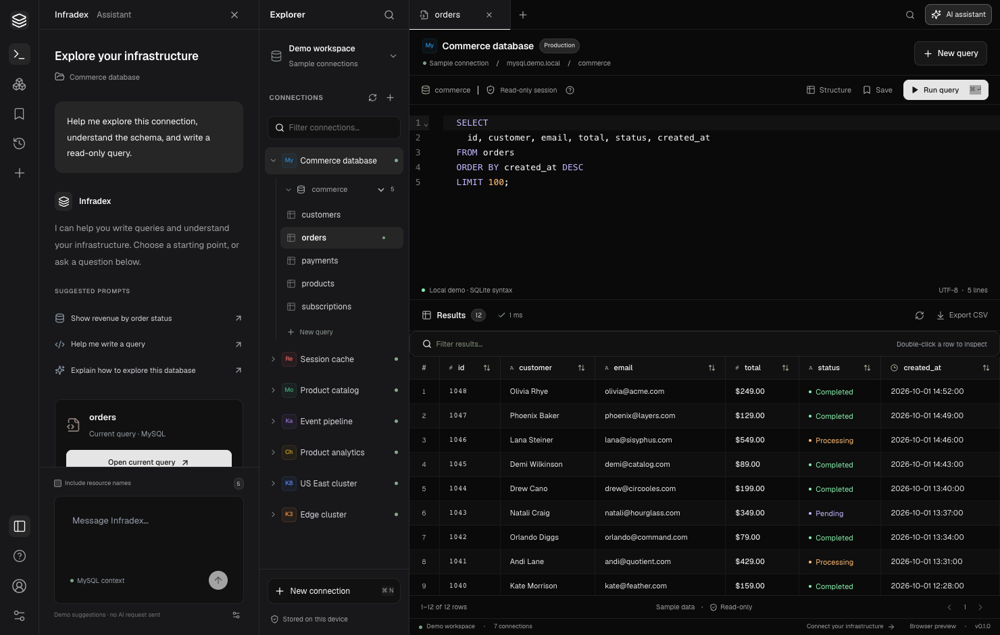

# Infradex

A desktop workspace for databases, caches, event streams, and Kubernetes. Built with **Wails v2, Go, React, Vite, Tailwind CSS, and CodeMirror**, with **gotomicro/ego**, **ego-component/egorm**, and **ego-component/eredis** on the backend.

An English-language, Navicat-inspired **read-only exploration MVP**. First launch opens in a clearly labeled demo workspace. Optional draft recovery returns to the last workspace on later launches. Switch to **Personal workspace** or choose **New connection** to work with your own infrastructure. Full Navicat feature parity is a longer-term goal.

Product scope, milestones, and acceptance criteria: [implementation plan](PLAN.md).

The workspace uses a narrow navigation rail, a collapsible left AI task panel, an Explorer tree, and top-level query tabs above the editor and results. The neutral desktop styling follows the supplied visual reference; see the [design QA report](design-qa.md) for comparisons and viewport checks.



## Run

Prerequisites: Go 1.25+, Node.js 22.12+, npm, Wails v2.12, and the platform's Wails build prerequisites. macOS requires Xcode Command Line Tools. Windows requires WebView2; Linux requires the GTK/WebKit development dependencies in the [Wails installation guide](https://v2.wails.io/docs/gettingstarted/installation/).

```sh
npm ci --prefix frontend
wails dev
```

Desktop build:

```sh
wails build
open build/bin/infradex.app # macOS
```

Browser-only UI preview:

```sh
npm run dev --prefix frontend
# http://127.0.0.1:3415
```

Browser preview supports the demo workspace, local SQL queries, saved queries, result filtering/sorting, and CSV export. Live connections, OS keychain storage, kubeconfig selection, and AI provider calls require Wails. No unauthenticated network bridge to the Go backend is exposed.

## Included

- Seven connection profiles with environment labels, TLS options, tests, an engine capability catalog, and resource browsing.
- SSH tunnels for every engine: password, private key (including encrypted keys), or SSH Agent authentication; known_hosts or SHA256 host-key verification.
- Per-tab database scope for MySQL, ClickHouse, and MongoDB, plus namespace and context scope for Kubernetes/K3s. Switching the browser scope preserves existing query tabs.
- MongoDB authentication database, Extended JSON filters, projection, ordered sorting, and previous/next document batches.
- Kubeconfig context discovery and namespace selection, with explicit RBAC errors and a saved-namespace fallback.
- Cluster resource details, container status/restarts, UID-scoped events, and bounded Pod log snapshots (including previous container instances).
- SQL table columns/indexes/DDL inspection and Redis key type/TTL/value inspection with cursor-based key browsing.
- Resource tree, independent query tabs, CodeMirror editor, and Cmd/Ctrl+Enter execution.
- Result sorting, filtering, pagination, row inspection, precision-preserving SQL values, and CSV export.
- Session-only history (last 100 queries in the current workspace), saved queries in local browser/webview storage, and a Cmd/Ctrl+K connection palette.
- Independent demo/personal query tabs survive workspace switches. Optional startup recovery restores query drafts, active tabs, and database/context scopes without executing restored queries.
- AI settings for an OpenAI-compatible Chat Completions endpoint, including local providers. Model ID is user-supplied. Suggestions can be inserted into the editor and never execute automatically.
- OS keychain storage for passwords and API keys. Connection metadata is written atomically with owner-only file permissions. Passwords are not returned to the frontend after saving. Blank password fields preserve an existing secret.

## Connector capabilities

| Engine | Transport / component | Available operations |
| --- | --- | --- |
| MySQL | ego-component/egorm, MySQL driver | Test authentication, database/table navigation, columns/indexes/DDL, queries in server-side read-only transactions |
| Redis | ego-component/eredis; upstream go-redis for TLS or named ACL users | Test, SCAN cursor navigation with MATCH filtering, six key type previews, read-only commands |
| MongoDB | MongoDB Go driver | Test, database/collection navigation, JSON find with filter/projection/sort/skip/limit and batch navigation; configurable authSource (default admin) |
| Kafka | kafka-go, optional SASL/PLAIN and TLS | Test, list topics, inspect partitions, leaders, and replica counts |
| ClickHouse | HTTP/HTTPS interface (8123 / 8443) | Test, database/table navigation, columns/skipping indexes/DDL, SQL with readonly=1 and result limits |
| Kubernetes | client-go dynamic and typed core clients | Context/namespace navigation, resource lists/details, UID-scoped events, Pod log snapshots |
| K3s | Same client-go adapter | Same resource operations via kubeconfig |

Examples:

```sql
SELECT * FROM orders LIMIT 100;
```

```text
SCAN 0 COUNT 100
["GET", "a key with spaces"]
```

```json
{
  "collection": "products",
  "filter": {"active": true},
  "projection": {"name": 1, "price": 1},
  "sort": {"price": -1},
  "skip": 0,
  "limit": 100
}
```

```text
# Kafka editor: topic name, or all topics
order.created
topics

# Kubernetes / K3s: get <resource> [namespace]
get pods default
get deployments team-a
get nodes
```

MongoDB filters accept Extended JSON, such as `{"_id":{"$oid":"507f1f77bcf86cd799439011"}}`. `limit` defaults to 100 and must be 1–500; `skip` is 0–1,000,000. Sort field order is preserved and `_id` is appended as a tie-breaker when absent. **Previous batch / Next batch** executes a generated query and updates the editor. Editing the query disables batch navigation until it is rerun. The 50-row result pager only pages within the current fetched batch. Concurrent writes can change offset-based batches; use a range filter for deep pagination. Responses preserve BSON numeric/date/ObjectID types as canonical Extended JSON and enforce an 8 MiB encoded result budget.

Kubeconfig supports token or client-certificate authentication. The connection dialog lists context names and their clusters without returning credentials or running plugins. Selecting a context fills its default namespace; saving resolves the current context to an explicit name. Query tabs and history retain the context/namespace they were opened with. A namespace-list permission error does not prevent querying the namespace configured in connection settings. Exec-based authentication plugins are explicitly rejected in this version. An empty namespace or `*` lists across namespaces; saved empty scopes are normalized to `*`. Use read-only database accounts and least-privilege cluster credentials: application read modes supplement server permissions.

To inspect a cluster resource, run a list such as `get pods`, then double-click a result row or use the arrow beside its name. **Overview** shows metadata, labels and container state; **JSON** shows the read-only definition with managed fields omitted. **Events** matches the resource UID, not just its name, with a 200-event / 1 MiB preview limit. **Logs** lets you select application, init or ephemeral containers, change tail lines, inspect the previous container instance, refresh and copy the snapshot. Requests include timestamps and are bounded to 2,000 lines / 256 KiB, with a 20-second outer timeout. Log output is not stored or sent to AI. Empty output, expired events and missing previous instances are shown explicitly. The log view does not follow a live stream.

The inspector keeps the query result's context, namespace, resource type and UID, even after editor text or sidebar selection changes. A replaced resource requires reopening from refreshed results. Kubernetes RBAC still applies: resource details need `get`, events need `list events`, and logs need `get pods` plus `get pods/log`. Events/log permission errors remain local to their sections.

SQL/document results are capped at 500 rows/documents; cluster pages at 500 items. Queries have a 20-second outer context; driver initialization also has bounded connection timeouts. Cancellation stops or abandons the client request; a server may continue until its own timeout. MySQL and Kubernetes/K3s query previews also stop at an 8 MiB encoded result budget and show why the preview is partial. MySQL reports truncation only when another row exists or the byte budget is reached. Cluster previews omit managed fields. Redis responses can exceed 500 items, but query responses above 8 MiB are rejected with guidance to use bounded ranges or smaller SCAN batches. These are desktop preview limits: a driver may allocate a response or large row before checking it, so they are not a process-memory or network-transfer ceiling. Redis key browsing supports Load more keys and MATCH patterns. SCAN can return empty batches or duplicate keys while data changes; the UI keeps the cursor and deduplicates displayed names. Key-value previews show up to 100 collection entries or 64 KiB of string content. Value pagination remains a query-editor operation. Kafka and cluster adapters expose no mutations.

## SSH tunnels

In **New connection** or **Edit connection**, enable **Connect through SSH tunnel**. This is available for MySQL, Redis, MongoDB, Kafka, ClickHouse, Kubernetes and K3s.

1. Keep the database host and port set to the address reachable **from the SSH server**. For Kubernetes/K3s, the target comes from the selected kubeconfig context. `localhost` means the SSH server's loopback interface.
2. Enter the SSH host, port (usually 22), username and authentication method. Choose a private key file, enter an SSH password, or use an available SSH Agent. Encrypted private keys accept a passphrase. File paths support `~/`.
3. Use your existing `~/.ssh/known_hosts`, select another known_hosts file, or enter a trusted `SHA256:…` host-key fingerprint supplied by your administrator. Unknown or changed keys fail verification; the app does not automatically trust a presented key.
4. Click **Test connection**, then **Save connection**. The test authenticates to SSH and performs the engine's actual connectivity check.

Database passwords, SSH passwords and key passphrases have separate OS keychain entries. Private keys remain in the selected files. Saved secrets are never returned in connection metadata. Blank secret fields preserve their saved values; switching SSH authentication methods or disabling SSH and saving removes unused SSH secrets. Metadata/keychain updates roll back together on failure.

Each operation opens a short-lived SSH session, shares it across its internal reads, and closes it on completion or cancellation. Forwarding uses SSH TCP channels without exposing a local listener. Target DNS resolves on the SSH server. There is no fallback to a direct connection when SSH fails. Kafka's advertised broker connections also use the tunnel, so those advertised addresses must be reachable from the SSH server. Cluster context/namespace discovery, resource details, events and Pod log requests use the same transport path.

TLS remains independent of SSH: database hostname verification is preserved, and Kubernetes uses the original kubeconfig CA, client certificates and TLS server name. Use a hostname matching the server certificate when enabling TLS. HTTP environment proxies and kubeconfig proxy URLs are bypassed for tunneled requests. SSH support is single-hop; OpenSSH config aliases, ProxyCommand/ProxyJump and interactive keyboard authentication are not implemented. SSH Agent currently uses the Unix socket exposed by `SSH_AUTH_SOCK`; if the desktop app cannot access it, use a private key or password.

The tunnel uses Go's [SSH client](https://pkg.go.dev/golang.org/x/crypto/ssh) and [known_hosts verifier](https://pkg.go.dev/golang.org/x/crypto/ssh/knownhosts). Direct MySQL connections retain egorm; SSH MySQL uses the same upstream SQL driver with a context-bound connector, avoiding global per-connection registrations. Redis SSH uses the upstream driver to preserve custom dialing and TLS.

## AI and local storage

Configure **Settings → AI provider** with a base URL, model ID, and optional API key. Providers must implement `/chat/completions`. HTTPS is required except for loopback HTTP endpoints. Redirects are not followed. Changing the provider endpoint without entering a new key removes the previous provider's key.

Each request includes the prompt and engine name. **Include resource names** is off by default; enabling it sends visible resource names. Credentials and result rows are never automatically included. Each prompt is independent; displayed chat history is not sent as context. Resource names do not supply column definitions, so review generated queries.

Demo AI returns a labeled sample suggestion and makes no provider call. Demo SQL runs against a seeded, read-only SQLite WebAssembly database. Dialect-specific MySQL/ClickHouse syntax requires a live connection. Other demo engines use local sample responses.

Profiles live under `os.UserConfigDir()/Infradex/workspace.json` (macOS: `~/Library/Application Support/Infradex/workspace.json`). Secrets use the `infradex` service in the OS credential store. Saving secrets requires a working keychain and never falls back to plaintext. Saved queries are local text; history is in memory and clears when switching workspaces or closing the app. AI provider settings and their API key are read as one snapshot, so concurrent provider changes cannot pair a URL with another provider’s key.

## Architecture

```text
frontend/src/             React workspace, editor, dialogs, demo engine
frontend/src/api.ts       Typed facade over Wails bindings
app.go                    Desktop lifecycle, cancellation, file dialogs
internal/workspace/       Profiles, keychain, engine adapters, AI client
build/                    Platform metadata and application icon
artifacts/                Verified interface screenshots
```

Ego supplies component configuration/logging; Wails owns the desktop lifecycle. Ego container construction is serialized and temporary credential configuration is cleared afterward. The eredis version used here does not propagate named ACL users and can drop verified TLS configuration, so those modes use upstream go-redis. egorm imports the ClickHouse v1 SQL driver; the HTTP adapter avoids duplicate SQL driver registration from importing v2 alongside it. References: [ego components](https://github.com/gotomicro/ego#3-ego-component), [ClickHouse HTTP interface](https://clickhouse.com/docs/interfaces/http).

## OPC release checks

`infradexctl` validates a service release spec locally. It does not open SSH, write a release record, or change the read-only query workbench.

```sh
go run ./cmd/infradexctl release validate -f service.release.yaml
INFRADEX_CONFIG_DIR="$HOME/Library/Application Support/Infradex" go run ./cmd/infradexctl fleet list
```

Rules, fleet file format, and later apply order: [OPC release spec](docs/superpowers/specs/2026-10-21-opc-release-design.md).

## Verify

```sh
npm run build --prefix frontend
go test -race -timeout 60s ./...
go vet ./...
npm run test:e2e --prefix frontend
```

Playwright uses installed Google Chrome locally and its managed Chromium in CI. Browser tests cover queries, filters, sorting, row inspection, CSV, saved queries, tabs, all demo engines, errors, minimum window size, and a mocked Wails bridge for live connection/AI flows. Go unit tests use an in-memory vault, Redis protocol test server, and HTTP servers for Kubernetes, ClickHouse, and AI. The local integration suite has also passed against real MySQL, Redis, MongoDB, Kafka, ClickHouse, and an isolated K3s API server (used by both Kubernetes/K3s profiles), plus the real macOS keychain. Run `python3 tests/integration/run.py --keychain`; see [fixture instructions](tests/integration/README.md). The cluster fixture has no worker node: real API tests cover resource details, UID-filtered events, empty unscheduled-Pod logs and log-subresource RBAC. Nonempty log output, previous-instance options, response bounds and timeout cancellation are covered by HTTP protocol tests, not a running kubelet. Running-container log acceptance remains to be verified on a cluster with a worker node. This does not cover every server version, Kubernetes distribution, or authentication setup. Native desktop file dialogs remain a manual verification item.

## Workspace recovery

Open **Settings → Restore query drafts on startup** to enable recovery (off by default). It stores query text, tab titles, connection IDs, database/context scopes and the active workspace in local browser/webview storage. It does not serialize results, errors, history, AI messages or connection credentials. Query text itself can contain sensitive values and is **not encrypted**. Turning recovery off removes its saved copy without closing open tabs.

Draft changes save after a 300 ms debounce and flush on page exit or backgrounding. A forced process termination can lose the latest unsaved edits. Each workspace allows up to 100 saved tabs and the combined JSON is capped at 2,097,152 UTF-16 code units; the browser's own quota may be lower. Storage errors remain visible and the previous successful copy stays intact. Corrupt or unsupported recovery data is preserved while recovery is disabled. Deleted-connection tabs are removed only after connection metadata loads successfully. Restored queries never execute automatically; normal resource discovery still runs when a connection is selected. Use one active app window for recovery; cross-window conflict resolution is not implemented.

## Automated build checks

[Verify desktop](.github/workflows/verify.yml) runs on pushes and pull requests: locked npm installation, TypeScript/Vite build, Go race tests, `go vet`, browser regressions and a macOS Wails build. The downloadable CI artifact is explicitly **unsigned** and is intended for validation. The workflow must still be exercised on GitHub; local checks do not prove hosted runner behavior. Signing, notarization and release publishing are separate release gates.

## Next milestones

Not implemented: editable grids/write queries, schema editing, import, backup/restore, migrations/sync, custom TLS certificates, MongoDB SRV/replica sets, Redis Cluster/Sentinel, Kafka messages/consumer groups/SCRAM, live log streaming/exec, schema-aware AI column context, streaming AI, signed distribution installers. macOS arm64 is the locally verified package target; Windows/Linux builds require separate environment verification.
